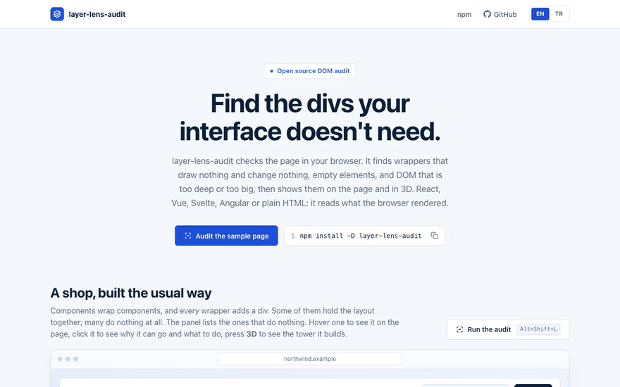

# layer-lens-audit

[](https://www.npmjs.com/package/layer-lens-audit)
[](https://github.com/hayrullah-zafer-yilmaz/layer-lens-audit/actions/workflows/ci.yml)
[](https://bundlejs.com/?q=layer-lens-audit)

[](LICENSE)

English · [Türkçe](docs/README.tr.md)

Find the divs your interface doesn't need.

layer-lens-audit checks a page for wrappers that draw nothing and change nothing, empty elements, and DOM that is too deep or too big. It shows them on the page and in an exploded 3D view, lists them on the command line and fails CI when new ones appear. It reads what the browser rendered, so it works the same with React, Vue, Svelte, Angular or plain HTML.

<p align="center">
  
</p>

[Live demo](https://hayrullah-zafer-yilmaz.github.io/layer-lens-audit/) · [npm](https://www.npmjs.com/package/layer-lens-audit)

- **Measured, not guessed:** every candidate's box is taken away for a moment, and it is only reported if nothing around it moves
- **Careful:** anything with a style, a job or a state it isn't in right now stays, and ids or test ids are flagged for you to check
- **Every screen size:** the command line measures the page on a phone and a desktop, and reports only what can go on both
- **Tells you where:** the component, and in Vue and Svelte the file, when the framework records it
- **Tells you why and what to do:** each finding says what was measured and how to fix it, with advice for React, Vue, Svelte and Angular and the markup before and after
- **Fast on big pages too:** elements that repeat are measured together, so a typical page takes well under 100 ms and one with 16,000 elements about 2 seconds
- **Fits your workflow:** a Vite plugin, a keyboard shortcut, a bookmarklet, a command for CI with a baseline, and reports as Markdown for pull requests
- **Leaves no trace:** the page is put back exactly as it was, down to the text of every `style` attribute
- **Speaks your language:** English and Turkish
- No runtime dependencies, about 26 KB gzipped in the browser

## What it reports

| Finding              | When                                                                                      |
| -------------------- | ----------------------------------------------------------------------------------------- |
| Wrapper that isn't needed | A `div` or `span` that can be unwrapped without any visible change. Nested ones are grouped. |
| Empty element        | An element with no content whose removal changes nothing. Always marked "check": scripts sometimes fill one later. |
| Too many elements    | More than 1,400 elements under the root.                                                  |
| Nested too deep      | More than 32 levels.                                                                      |
| Too many children    | An element with more than 60 children.                                                    |

The limits are the ones Lighthouse's DOM size audit warns about, and you can change them.

## How it decides

An element is only reported when all of these hold. Anything in doubt stays.

1. **It draws nothing:** no background, border, shadow, outline, `::before` or `::after`, and no effect such as clipping, positioning, a transform, opacity, a filter, z-index, containment, a transition or an animation.
2. **It styles nothing inside it:** it sets no inherited style such as colour or font, no custom property its children use, and no rule styles other elements through it (`.card > .title`, `.group:hover .icon`, `:has()`, Tailwind's `*:` variants).
3. **Nothing moves without it:** it is unwrapped with `display: contents` (an empty element is hidden) and its parent, its siblings, its children and its text are measured again. A difference of more than half a pixel keeps it. Everything reported is removable together, not just one at a time.
4. **Nothing else needs it:** no `role`, `aria-*`, `tabindex`, `href` or `title`; no React, Vue, Svelte, Angular or jQuery event handler; no React or Vue ref; no styles that apply on `:hover`, in dark mode, when a class is toggled, at another screen size or under a container query; no size limit such as `max-width` that can bind at another screen size; and no sibling styled by its position (`:first-child`, `* + *`) that would shift.

Elements with an `id` or `data-*` attributes are still reported, marked "check", with a note on what may rely on them.

## Use it while you develop

```sh
npm install --save-dev layer-lens-audit
```

### With Vite

```js
// vite.config.js
import { layerLensAudit } from 'layer-lens-audit/vite';

export default {
  plugins: [layerLensAudit()]
};
```

Start the dev server and press <kbd>Alt</kbd> + <kbd>Shift</kbd> + <kbd>L</kbd> on any page. Nothing in your app changes, and builds don't include it. The plugin takes the same options as `installInspector()`, with `root` as a selector.

### With anything else

```js
import { installInspector } from 'layer-lens-audit';

if (process.env.NODE_ENV === 'development') installInspector();
```

In Next.js, put it in a client component:

```jsx
'use client';
import { useEffect } from 'react';

export function LayerLensAudit() {
  useEffect(() => {
    if (process.env.NODE_ENV === 'development') import('layer-lens-audit').then(({ installInspector }) => installInspector());
  }, []);
  return null;
}
```

Change the keys with `installInspector({ shortcut: 'Ctrl+Shift+K' })`.

### The panel

The panel lists the findings. Hover one to outline it on the page. Click it to scroll to it and read why it can go and what to do about it; for wrappers it also shows the markup as it is and as it would be without them. Press **3D** to see it in an exploded view where the elements that can go rise as red plates. In 3D, drag to turn the view and Shift + drag to move it; zoom with Ctrl + scroll, a pinch, the + and − keys or the buttons in the panel, and press 0 to reset it. **Outline them on the page** marks everything at once. **Copy as Markdown** gives you a table to paste into a pull request or an issue; **Copy as JSON** gives you the data. The results are also logged to the console.

### On any page, without installing

Make a bookmark with this as its address and click it on any page:

```text
javascript:(()=>{if(window.LayerLensAudit)return LayerLensAudit.inspect();const s=document.createElement('script');s.src='https://unpkg.com/layer-lens-audit';s.onload=()=>LayerLensAudit.inspect();document.head.append(s)})()
```

Sites with a strict Content Security Policy block scripts from other origins, so the bookmarklet won't load there. The command line works on those too.

## Use it on the command line and in CI

```sh
npx layer-lens-audit http://localhost:5173
```

```text
layer-lens-audit  http://localhost:5173/
Measured at 390 × 844 and 1440 × 900.
Without them the DOM would be 19 levels deep instead of 28.

41 of 1,240 elements could go (3.3%).

● 3 nested wrappers aren't needed  ProductCard.vue
  main > div.grid > div.card-body
● This empty div isn't needed  check
  footer > div.clearfix
  Scripts sometimes fill an empty element later: check that none does.

How to fix
  Wrappers: Delete the wrapper tags and keep what is inside them where it is. In Vue a component can have several root elements, and <template> groups elements without adding one to the page.
  Empty elements: Delete the element.
```

It opens the page in a headless Chrome at each screen size, loads it fresh each time, and reports only what can go at every size. It needs Node 22 or later and Chrome, Chromium or Edge, which it finds on its own.

| Option                  | What it does                                                                     |
| ----------------------- | -------------------------------------------------------------------------------- |
| `--viewports <sizes>`   | Screen sizes, comma-separated. Default `390x844,1440x900`.                       |
| `--root <selector>`     | Where to look. Default `body`.                                                   |
| `--ignore <selector>`   | Leave these elements out, with everything inside them.                           |
| `--wait <ms>`           | Wait this long after the page loads. Default `1000`.                             |
| `--wait-for <selector>` | Wait until this element is on the page, for apps that render after loading.      |
| `--format <format>`     | `text`, `markdown` or `json`. Default `text`.                                    |
| `--output <file>`       | Also write the report to this file.                                              |
| `--max <count>`         | Exit with 1 when more than this many elements can go.                            |
| `--baseline <file>`     | Only count elements that are not in this baseline.                              |
| `--update-baseline`     | Save what can go now as the baseline.                                            |
| `--locale <en\|tr>`     | Language of the report. Default: the system's.                                   |
| `--chrome <path>`       | The browser to use. Default: `CHROME_PATH`, then the usual install places.       |

It exits with 0 when all is well, 1 when `--max` is exceeded and 2 on errors. A file path works in place of a URL.

### Adopting it on an existing project

Save what can go today as a baseline and commit it:

```sh
npx layer-lens-audit http://localhost:5173 --baseline layer-lens-audit.json --update-baseline
```

Then let CI fail only when something new appears:

```yaml
- run: npm run build
- run: npx vite preview --port 4173 & sleep 2
- run: npx layer-lens-audit http://localhost:4173 --baseline layer-lens-audit.json --max 0 --format markdown --output layer-lens-audit.md
```

Fix the old findings at your own pace and update the baseline as you go.

## Use it from code

```js
import { audit } from 'layer-lens-audit';

const report = await audit({ root: '#app' });
console.log(report.summary()); // "41 of 1,240 elements could go (3.3%)."
console.log(report.toMarkdown());
```

## Mark elements in your markup

```html
<!-- Needed for a reason the audit can't see: never report it, but look inside. -->
<div data-layer-lens-audit="keep">…</div>

<!-- Not ours, such as a third-party widget: leave it out with everything inside it. -->
<div data-layer-lens-audit="ignore">…</div>
```

## Options

`audit()`, `inspect()` and `installInspector()` take the same options:

| Option       | Default         | What it does                                                                      |
| ------------ | --------------- | --------------------------------------------------------------------------------- |
| `root`       | `document.body` | Where to look: an element or a selector.                                          |
| `ignore`     |                 | A selector for elements to leave out with everything inside them.                 |
| `limits`     | `{ elements: 1400, depth: 32, children: 60 }` | Override any of the DOM size limits.                  |
| `locale`     | the browser's   | `'en'` or `'tr'`. Titles, notes, the summary and the panel are written in it. Any other language falls back to English. |
| `signal`     |                 | An `AbortSignal` to stop the audit (`audit()` only).                              |
| `onProgress` |                 | Called with `(done, total)` while the audit runs (`audit()` only).                |
| `shortcut`   | `'Alt+Shift+L'` | The keys that open and close the inspector (`installInspector()` only).           |

## The report

`audit()` resolves to a report with:

| Member         | What it holds                                                                                 |
| -------------- | --------------------------------------------------------------------------------------------- |
| `findings`     | Each finding's `kind`, `elements`, `confidence` (`high` or `medium`), `title`, `detail` (why), `fix` (what to do), `notes`, `selector` and `source`. |
| `removable`    | How many elements can go.                                                                     |
| `stats`        | The DOM now: `elements`, `depth` and the most `children` of one element.                      |
| `cleaned`      | The same numbers without everything that can go.                                              |
| `viewport`     | The window size the layout was measured at.                                                   |
| `locale`       | The language of the titles, details, notes and summary. The `kind` of each finding stays in English, for code to read. |
| `summary()`    | One sentence for a log line or a CI message.                                                  |
| `toMarkdown()` | A table to paste into a pull request or an issue, with what to do about each kind of finding. |
| `toJSON()`     | Plain data with selectors instead of elements, ready to save or send.                         |

`source` says where an element comes from when the framework records it: the component's name and file in Vue development builds, the location in Svelte development builds, the component's name in React and Angular. In production builds names are usually minified, and layer-lens-audit leaves those out.

## The 3D view

The inspector's 3D view is also available on its own, for any element:

```js
import { createLayerLensAudit } from 'layer-lens-audit';

const lens = createLayerLensAudit(document.querySelector('#card'), { depth: 'dom' });
await lens.open();
```

It takes `spacing`, `tilt`, `turn`, `perspective`, `duration`, `depth` (`'visual'` or `'dom'`), `interactive`, `outlines`, `color`, `marks` (elements to show in red), `markLabel`, `onOpenChange` and `onZoomChange`, and returns `open()`, `close()`, `toggle()`, `update()` and `destroy()`.

The view fits inside the element's own box, so it never covers the page around it. To look closer, zoom it: Ctrl + scroll or a pinch, the + and − keys, or `setZoom()` from code, between 50% and 400%. Shift + drag moves it, a plain drag turns it, and 0 or `resetView()` brings it back. `zoom` holds the current zoom.

## Limitations

- **In the browser, one screen size and one state at a time.** Elements with responsive, state or dark mode styles are kept for that reason; the command line also measures several screen sizes. Layout that a script changes later can't be predicted.
- **Event listeners added with `addEventListener` are invisible** to scripts on the page. Handlers set by React, Vue, Svelte, Angular and jQuery are found, as are inline `on…` attributes. Mark such elements with `data-layer-lens-audit="keep"`.
- **Code that selects elements** with `querySelector` or a test selector by class can't be seen. Ids and `data-*` attributes are pointed out, class names are not.
- **Style sheets from other origins** can't be read, so rules in them that style children through a wrapper are missed. The panel says how many it couldn't read.
- **Shadow DOM and iframes** are not looked into.

## Browser support

Tested in Chrome. It only uses standard APIs, so current versions of Edge, Firefox and Safari should work too; reports from those are welcome. The command line needs Node 22 or later.

## Contributing

See [CONTRIBUTING.md](CONTRIBUTING.md). The most useful report is a false positive: an element layer-lens-audit says can go, but that is needed.

## License

[MIT](LICENSE)
