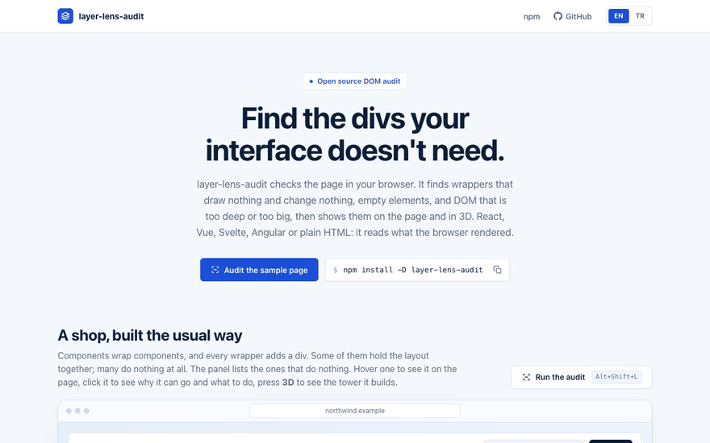

# layer-lens-audit

[](https://www.npmjs.com/package/layer-lens-audit)
[](https://github.com/hayrullah-zafer-yilmaz/layer-lens-audit/actions/workflows/ci.yml)
[](https://bundlejs.com/?q=layer-lens-audit)

[](../LICENSE)

[English](../README.md) · Türkçe

Arayüzünüzün ihtiyaç duymadığı div'leri bulun.

layer-lens-audit bir sayfada hiçbir şey çizmeyen ve hiçbir şeyi değiştirmeyen sarmalayıcıları (wrapper), boş elemanları ve fazla derin ya da fazla büyük DOM'u bulur. Bunları sayfada ve parçalarına ayrılmış bir 3D görünümde gösterir, komut satırında listeler ve yenileri çıktığında CI'ı durdurur. Tarayıcının çizdiği sonuca baktığı için React, Vue, Svelte, Angular ya da düz HTML'de aynı şekilde çalışır.

<p align="center">
  
</p>

[Canlı demo](https://hayrullah-zafer-yilmaz.github.io/layer-lens-audit/) · [npm](https://www.npmjs.com/package/layer-lens-audit)

- **Tahmin etmez, ölçer:** her adayın kutusu bir anlığına kaldırılır ve ancak çevresinde hiçbir şey kaymıyorsa raporlanır
- **Temkinlidir:** stili, bir görevi ya da şu an içinde olmadığı bir durumu olan her şey yerinde kalır; id ya da test id taşıyanlar kontrol etmeniz için işaretlenir
- **Her ekran boyutunda:** komut satırı sayfayı hem telefonda hem masaüstünde ölçer ve sadece ikisinde de kaldırılabilenleri raporlar
- **Nerede olduğunu söyler:** framework kaydediyorsa component'i, Vue ve Svelte'te dosyayı da gösterir
- **Nedenini ve ne yapmanız gerektiğini söyler:** her bulgu neyin ölçüldüğünü ve nasıl düzeltileceğini anlatır; React, Vue, Svelte ve Angular için öneri verir, kodun önceki ve sonraki halini gösterir
- **Büyük sayfalarda da hızlıdır:** tekrarlanan elemanlar birlikte ölçülür; sıradan bir sayfa 100 ms'nin çok altında, 16.000 elemanlı bir sayfa yaklaşık 2 saniyede denetlenir
- **Çalışma düzeninize uyar:** Vite eklentisi, klavye kısayolu, bookmarklet, referans raporlu CI komutu ve pull request'ler için Markdown rapor
- **İz bırakmaz:** sayfa, her `style` attribute'unun metnine kadar tam olarak eski haline getirilir
- **Sizin dilinizi konuşur:** İngilizce ve Türkçe
- Çalışma zamanı bağımlılığı yok; tarayıcıda gzip'le yaklaşık 26 KB

## Neleri raporlar

| Bulgu                           | Ne zaman                                                                            |
| ------------------------------- | ----------------------------------------------------------------------------------- |
| Gereksiz sarmalayıcı           | Görünürde hiçbir şey değişmeden açılabilen bir `div` ya da `span`. İç içe olanlar tek bulguda toplanır. |
| Boş eleman                      | Kaldırılınca hiçbir şeyi değiştirmeyen, içi boş bir eleman. Her zaman "kontrol edin" diye işaretlenir: script'ler bazen boş bir elemanı sonradan doldurur. |
| Fazla eleman                    | Kökün altında 1.400'den fazla eleman.                                               |
| Fazla derin                     | 32 seviyeden fazla iç içelik.                                                       |
| Fazla çocuk                     | 60'tan fazla çocuğu olan bir eleman.                                                |

Sınırlar Lighthouse'un DOM boyutu denetiminin uyardığı sınırlarla aynıdır ve değiştirilebilir.

## Nasıl karar verir

Bir eleman ancak bunların hepsi doğruysa raporlanır. Şüpheli olan her şey yerinde kalır.

1. **Hiçbir şey çizmiyor:** arka plan, kenarlık, gölge, outline, `::before` ya da `::after` yok; kırpma, konumlandırma, transform, opacity, filtre, z-index, containment, transition ya da animasyon gibi bir etkisi de yok.
2. **İçindekilere stil vermiyor:** renk ya da font gibi miras kalan bir stil vermiyor, çocuklarının kullandığı bir custom property tanımlamıyor ve hiçbir kural başka elemanları onun üzerinden stillemiyor (`.card > .title`, `.group:hover .icon`, `:has()`, Tailwind'in `*:` varyantları).
3. **Onsuz hiçbir şey kaymıyor:** `display: contents` ile açılır (boş bir eleman gizlenir), sonra ebeveyni, kardeşleri, çocukları ve metni yeniden ölçülür. Yarım pikselden büyük bir fark onu yerinde tutar. Raporlanan her şey tek tek değil, hep birlikte kaldırılabilir.
4. **Başka hiçbir şey ona bağlı değil:** `role`, `aria-*`, `tabindex`, `href` ya da `title` yok; React, Vue, Svelte, Angular ya da jQuery event handler'ı yok; React ya da Vue ref'i yok; `:hover`'da, dark mode'da, bir class açılıp kapandığında, başka bir ekran boyutunda ya da bir container query altında uygulanan stili yok; başka bir ekran boyutunda devreye girebilecek `max-width` gibi bir boyut sınırı yok; ve konumuna göre stil alan, kayacak bir kardeşi yok (`:first-child`, `* + *`).

`id` ya da `data-*` attribute'u taşıyan elemanlar yine raporlanır, ama "kontrol edin" diye işaretlenir ve neyin onlara bağlı olabileceği notla yazılır.

## Geliştirirken kullanın

```sh
npm install --save-dev layer-lens-audit
```

### Vite ile

```js
// vite.config.js
import { layerLensAudit } from 'layer-lens-audit/vite';

export default {
  plugins: [layerLensAudit()]
};
```

Geliştirme sunucusunu başlatın ve herhangi bir sayfada <kbd>Alt</kbd> + <kbd>Shift</kbd> + <kbd>L</kbd> tuşlarına basın. Uygulamanızın kodunda hiçbir şey değişmez ve build'lere eklenmez. Eklenti `installInspector()` ile aynı seçenekleri alır; `root` bir seçici olarak verilir.

### Diğer her şeyle

```js
import { installInspector } from 'layer-lens-audit';

if (process.env.NODE_ENV === 'development') installInspector();
```

Next.js'te bunu bir client component'e koyun:

```jsx
'use client';
import { useEffect } from 'react';

export function LayerLensAudit() {
  useEffect(() => {
    if (process.env.NODE_ENV === 'development') import('layer-lens-audit').then(({ installInspector }) => installInspector());
  }, []);
  return null;
}
```

Tuşları `installInspector({ shortcut: 'Ctrl+Shift+K' })` ile değiştirebilirsiniz.

### Panel

Panel bulguları listeler. Bir bulgunun üzerine geldiğinizde sayfada işaretlenir. Tıkladığınızda sayfa oraya kaydırılır, panelde de neden kaldırılabileceği ve ne yapmanız gerektiği açılır; sarmalayıcılarda kodun şimdiki hali ve onlar olmadan alacağı hal de gösterilir. **3D** butonu onu, kaldırılabilecek elemanların kırmızı plakalar olarak yükseldiği bir görünümde gösterir. 3D'de görünümü sürükleyerek döndürün, Shift ile sürükleyerek taşıyın; Ctrl ile kaydırarak, iki parmakla, + ve − tuşlarıyla ya da paneldeki butonlarla yakınlaştırın, 0 tuşuyla sıfırlayın. **Hepsini sayfada işaretle** her şeyi bir kerede gösterir. **Markdown olarak kopyala** bir pull request'e ya da issue'ya yapıştırabileceğiniz bir tablo verir; **JSON olarak kopyala** veriyi verir. Sonuçlar konsola da yazılır.

### Kurmadan, herhangi bir sayfada

Adresi bu olan bir yer imi oluşturun ve denetlemek istediğiniz sayfada ona tıklayın:

```text
javascript:(()=>{if(window.LayerLensAudit)return LayerLensAudit.inspect();const s=document.createElement('script');s.src='https://unpkg.com/layer-lens-audit';s.onload=()=>LayerLensAudit.inspect();document.head.append(s)})()
```

Sıkı bir Content Security Policy kullanan siteler başka kaynaklardan gelen script'leri engeller, bu yüzden bookmarklet oralarda yüklenmez. Komut satırı o sitelerde de çalışır.

## Komut satırında ve CI'da kullanın

```sh
npx layer-lens-audit http://localhost:5173
```

```text
layer-lens-audit  http://localhost:5173/
390 × 844 ve 1440 × 900 boyutlarında ölçüldü.
Onlar olmadan DOM derinliği 28 yerine 19 seviye olur.

1.240 elemandan 41 tanesi kaldırılabilir (%3,3).

● İç içe 3 sarmalayıcı gereksiz  ProductCard.vue
  main > div.grid > div.card-body
● Bu boş div gereksiz  kontrol edin
  footer > div.clearfix
  Script'ler boş bir elemanı bazen sonradan doldurur: doldurmadıklarından emin olun.

Nasıl düzeltilir
  Sarmalayıcılar: Sarmalayıcı etiketlerini silin, içindekileri olduğu yerde bırakın. Vue'da bir bileşenin birden fazla kök elemanı olabilir; <template> da sayfaya eleman eklemeden gruplar.
  Boş elemanlar: Elemanı silin.
```

Sayfayı her ekran boyutunda başlıksız (headless) bir Chrome'da, her seferinde yeniden yükleyerek açar ve sadece her boyutta kaldırılabilenleri raporlar. Node 22 ya da üstü ve Chrome, Chromium ya da Edge gerekir; tarayıcıyı kendisi bulur.

| Seçenek                 | Ne yapar                                                                          |
| ----------------------- | --------------------------------------------------------------------------------- |
| `--viewports <sizes>`   | Virgülle ayrılmış ekran boyutları. Varsayılan `390x844,1440x900`.                 |
| `--root <selector>`     | Nereye bakılacağı. Varsayılan `body`.                                             |
| `--ignore <selector>`   | Bu elemanları içindekilerle birlikte dışarıda bırakır.                            |
| `--wait <ms>`           | Sayfa yüklendikten sonra bu kadar bekler. Varsayılan `1000`.                      |
| `--wait-for <selector>` | Bu eleman sayfada görünene kadar bekler; yüklendikten sonra çizilen uygulamalar için. |
| `--format <format>`     | `text`, `markdown` ya da `json`. Varsayılan `text`.                               |
| `--output <file>`       | Raporu ayrıca bu dosyaya yazar.                                                   |
| `--max <count>`         | Bundan fazla eleman kaldırılabiliyorsa 1 koduyla çıkar.                           |
| `--baseline <file>`     | Sadece bu referans raporda olmayan elemanları sayar.                              |
| `--update-baseline`     | Şu an kaldırılabilenleri referans rapor olarak kaydeder.                          |
| `--locale <en\|tr>`     | Raporun dili. Varsayılan: sistemin dili.                                          |
| `--chrome <path>`       | Kullanılacak tarayıcı. Varsayılan: `CHROME_PATH`, sonra bilinen kurulum yerleri.  |

Her şey yolundaysa 0, `--max` aşıldıysa 1, bir hata olduysa 2 koduyla çıkar. URL yerine bir dosya yolu da verilebilir.

### Mevcut bir projeye eklemek

Bugün kaldırılabilenleri referans rapor olarak kaydedin ve commit'leyin:

```sh
npx layer-lens-audit http://localhost:5173 --baseline layer-lens-audit.json --update-baseline
```

Sonra CI'ın sadece yeni bir şey çıktığında durmasını sağlayın:

```yaml
- run: npm run build
- run: npx vite preview --port 4173 & sleep 2
- run: npx layer-lens-audit http://localhost:4173 --baseline layer-lens-audit.json --max 0 --format markdown --output layer-lens-audit.md
```

Eski bulguları kendi hızınızda düzeltin ve ilerledikçe referans raporu güncelleyin.

## Koddan kullanın

```js
import { audit } from 'layer-lens-audit';

const report = await audit({ root: '#app', locale: 'tr' });
console.log(report.summary()); // "1.240 elemandan 41 tanesi kaldırılabilir (%3,3)."
console.log(report.toMarkdown());
```

## Elemanları HTML'de işaretleyin

```html
<!-- Denetimin göremediği bir nedenle gerekli: asla raporlanmaz, ama içine bakılır. -->
<div data-layer-lens-audit="keep">…</div>

<!-- Bizim değil, örneğin üçüncü taraf bir widget: içindekilerle birlikte dışarıda bırakılır. -->
<div data-layer-lens-audit="ignore">…</div>
```

## Seçenekler

`audit()`, `inspect()` ve `installInspector()` aynı seçenekleri alır:

| Seçenek      | Varsayılan      | Ne yapar                                                                           |
| ------------ | --------------- | ---------------------------------------------------------------------------------- |
| `root`       | `document.body` | Nereye bakılacağı: bir eleman ya da bir seçici.                                    |
| `ignore`     |                 | İçindekilerle birlikte dışarıda bırakılacak elemanlar için bir seçici.             |
| `limits`     | `{ elements: 1400, depth: 32, children: 60 }` | DOM boyutu sınırlarından herhangi birini değiştirir.   |
| `locale`     | tarayıcınınki   | `'en'` ya da `'tr'`. Başlıklar, notlar, özet ve panel bu dilde yazılır. Başka bir dil İngilizceye düşer. |
| `signal`     |                 | Denetimi durdurmak için bir `AbortSignal` (sadece `audit()`).                      |
| `onProgress` |                 | Denetim sürerken `(done, total)` ile çağrılır (sadece `audit()`).                  |
| `shortcut`   | `'Alt+Shift+L'` | İnceleme panelini açıp kapatan tuşlar (sadece `installInspector()`).               |

## Rapor

`audit()` şunları içeren bir raporla sonuçlanır:

| Üye            | İçinde ne var                                                                                 |
| -------------- | --------------------------------------------------------------------------------------------- |
| `findings`     | Her bulgunun `kind`, `elements`, `confidence` (`high` ya da `medium`), `title`, `detail` (neden), `fix` (ne yapmalı), `notes`, `selector` ve `source` bilgisi. |
| `removable`    | Kaç elemanın kaldırılabileceği.                                                               |
| `stats`        | DOM'un şimdiki hali: `elements`, `depth` ve tek bir elemanın en fazla `children` sayısı.      |
| `cleaned`      | Kaldırılabilecek her şey gittiğinde aynı sayılar.                                             |
| `viewport`     | Yerleşimin ölçüldüğü pencere boyutu.                                                          |
| `locale`       | Başlıkların, açıklamaların, notların ve özetin dili. Her bulgunun `kind` değeri, kodun okuyabilmesi için İngilizce kalır. |
| `summary()`    | Bir log satırı ya da CI mesajı için tek bir cümle.                                            |
| `toMarkdown()` | Bir pull request'e ya da issue'ya yapıştırılacak, her bulgu türü için ne yapılacağını da söyleyen bir tablo. |
| `toJSON()`     | Eleman yerine seçici içeren, kaydetmeye ya da göndermeye hazır düz veri.                      |

`source`, framework kaydediyorsa elemanın nereden geldiğini söyler: Vue geliştirme build'lerinde component'in adı ve dosyası, Svelte geliştirme build'lerinde konumu, React ve Angular'da component'in adı. Production build'lerinde isimler genellikle küçültülmüş olur ve layer-lens-audit bunları göstermez.

## 3D görünüm

İnceleme panelinin 3D görünümü tek başına, herhangi bir eleman için de kullanılabilir:

```js
import { createLayerLensAudit } from 'layer-lens-audit';

const lens = createLayerLensAudit(document.querySelector('#card'), { depth: 'dom' });
await lens.open();
```

`spacing`, `tilt`, `turn`, `perspective`, `duration`, `depth` (`'visual'` ya da `'dom'`), `interactive`, `outlines`, `color`, `marks` (kırmızı gösterilecek elemanlar), `markLabel`, `onOpenChange` ve `onZoomChange` seçeneklerini alır; `open()`, `close()`, `toggle()`, `update()` ve `destroy()` döndürür.

Görünüm elemanın kendi kutusuna sığdırılır, böylece çevresindeki sayfayı örtmez. Daha yakından bakmak için yakınlaştırın: Ctrl ile kaydırarak ya da iki parmakla, + ve − tuşlarıyla ya da koddan `setZoom()` ile, %50 ile %400 arasında. Shift ile sürüklemek görünümü taşır, normal sürüklemek döndürür; 0 tuşu ya da `resetView()` başa döndürür. `zoom` o anki yakınlaştırmayı verir.

## Sınırlar

- **Tarayıcıda bir seferde tek ekran boyutu ve tek durum.** Responsive, durum ya da dark mode stili olan elemanlar bu yüzden yerinde tutulur; komut satırı ayrıca birden fazla ekran boyutunda ölçer. Bir script'in sonradan değiştireceği yerleşim önceden bilinemez.
- **`addEventListener` ile eklenmiş event listener'lar görünmez:** sayfadaki script'ler bunları göremez. React, Vue, Svelte, Angular ve jQuery'nin eklediği handler'lar ile satır içi `on…` attribute'ları bulunur. Böyle elemanları `data-layer-lens-audit="keep"` ile işaretleyin.
- **Elemanları `querySelector` ile ya da class'a göre seçen kod** görünmez. Id ve `data-*` attribute'ları gösterilir, class adları gösterilmez.
- **Başka kaynaklardan gelen stil dosyaları** okunamaz; bu yüzden içlerinde çocukları bir sarmalayıcı üzerinden stilleyen kurallar gözden kaçar. Panel kaç tanesini okuyamadığını söyler.
- **Shadow DOM ve iframe'lerin** içine bakılmaz.

## Tarayıcı desteği

Chrome'da test edildi. Sadece standart API'ler kullanıyor, bu yüzden Edge, Firefox ve Safari'nin güncel sürümlerinde de çalışması beklenir; bu tarayıcılardan gelecek geri bildirimler memnuniyetle karşılanır. Komut satırı Node 22 ya da üstünü gerektirir.

## Katkıda bulunun

[CONTRIBUTING.md](../CONTRIBUTING.md) dosyasına bakın. En faydalı bildirim bir yanlış alarmdır: layer-lens-audit'in kaldırılabilir dediği ama aslında gerekli olan bir eleman.

## Lisans

[MIT](../LICENSE)
